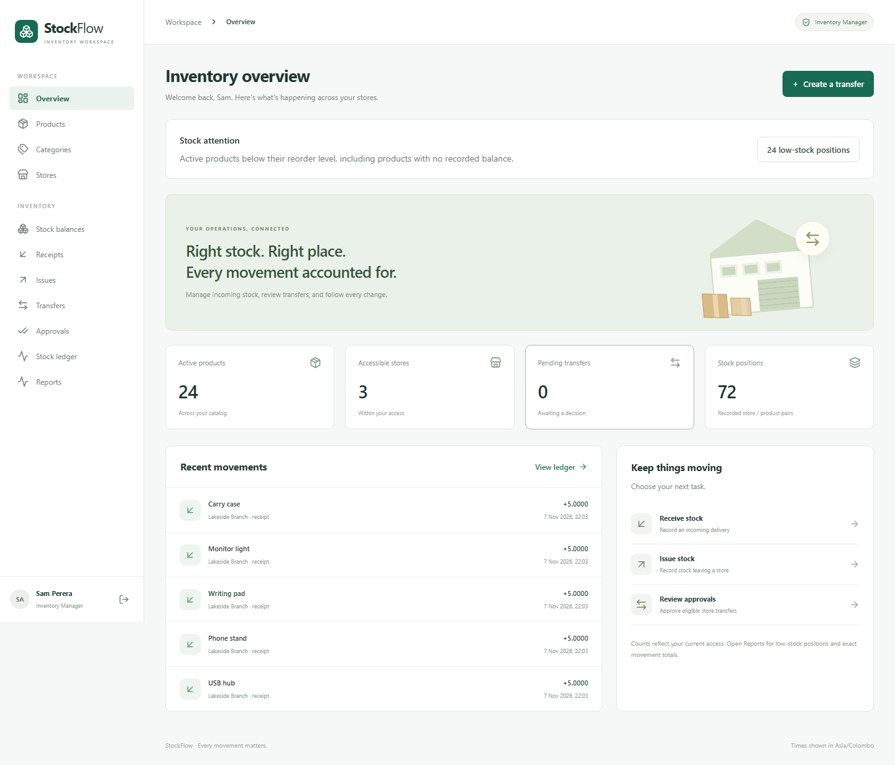
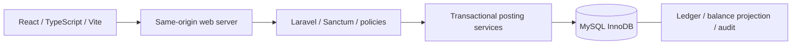

# StockFlow

StockFlow is a fictional multi-store inventory demo with a Laravel API and responsive React workspace. It demonstrates scoped access, atomic receipts/issues, separately approved transfers, exact stock quantities and traceable movement history.



## Architecture



## Quick start (PowerShell)

Prerequisites: Git, PHP 8.3+ with PDO MySQL, BCMath, mbstring, XML, curl and zip, Composer 2, Node 24 and MySQL. Provision a dedicated `stockflow` database and user with privileges only on that database.

```powershell
git clone https://github.com/chanakanaveen/stockflow.git
cd stockflow/backend
composer install
Copy-Item .env.example .env
php artisan key:generate
```

Edit ignored `backend/.env`: configure the dedicated database connection, set `APP_URL=http://127.0.0.1:5173`, `DEMO_ENABLED=true`, and choose a unique `DEMO_PASSWORD` of at least 12 characters. Keep `APP_ENV=local`.

```powershell
php artisan migrate --seed
php artisan serve --host=127.0.0.1 --port=18000
```

In a second terminal, from the repository:

```powershell
cd frontend
npm ci
npm run dev
```

Open [the local app](http://127.0.0.1:5173). Use `manager@stockflow.test` or `admin@stockflow.test` with your configured password. `keeper@stockflow.test` has Main Warehouse access; `auditor@stockflow.test` is read-only. Default seeding supplies accounts and stores, not the populated screenshot dataset. Follow the [demo walkthrough](docs/demo.md) for the isolated 24-product browser fixture. Demo seeding refuses production and does not reset existing passwords.

## Release and portfolio material

- [Actual screenshot gallery and reproducible demo](docs/demo.md)
- [API examples](docs/api-examples.md) and [OpenAPI contract](docs/openapi.json)
- [Deployment and recovery runbook](docs/deployment.md)
- [Video script and portfolio description](docs/portfolio.md)
- [Release evidence and hygiene](docs/release-checklist.md)
- [Phase 6 verification](docs/phase6-verification.md) and [limitations/roadmap](docs/roadmap.md)

No public deployment, recorded video, commercial results or production capacity claim is included. Full Compose execution and backup restoration remain unverified. Phase 5 recorded 12 moderate development-tool advisories and zero production dependency advisories; those results are dated evidence. No open-source license has been selected. Third-party packages retain their own licenses; Composer/npm lockfiles identify the dependency inventory.

## Checks

Configure the isolated `stockflow_test` database/user first using [setup](docs/setup.md). Browser tests intentionally reset that schema; run them after backend tests, never concurrently.

```powershell
cd backend
php artisan test
php vendor/bin/pint --test
php vendor/bin/phpstan analyse --no-progress --memory-limit=512M
composer validate --strict
cd ../frontend
npm run typecheck
npm run lint
npm run test -- --run
npm run build
npx playwright install chromium
npm run test:e2e
cd ../backend
php artisan inventory:reconcile --env=testing
cd ..
node scripts/verify-openapi.mjs
node scripts/verify-docs.mjs
```

Phase 5 recorded 62 backend tests / 476 assertions, 18 UI tests and green Linux/MySQL 8.4 CI. Phase 6 reran the three browser scenarios, fresh-checkout setup/build/authentication, reconciliation and documentation checks; it did not rerun the full backend suite. Its fresh dependency audit reports seven moderate development advisories and zero production vulnerabilities. See [dated verification evidence](docs/phase6-verification.md).

## Application and verification history

StockFlow is a multi-store inventory management project with a responsive React workspace and Laravel API. It supports secure sign-in, role-based store access, inventory masters, atomic receipts/issues, approved transfers, balances and a permanent stock ledger.

Implemented foundation:
- Cookie-based login, session inspection and logout, with CSRF protection.
- Active-account enforcement, four seeded roles and granular permissions.
- Server-enforced store scope and an admin-only user listing.
- Opt-in fictional demo accounts, isolated MySQL tests and a local Compose configuration.

Phase 2 adds category/product/store management, receipt/issue drafts, transactional posting, exact decimal balances, an immutable ledger, idempotent retries, audit records and reconciliation. See the [Phase 2 report](docs/phase2-verification.md) for APIs, commands and verification.

Phase 3 adds transfers with submission, eligible approvals, rejection, cancellation and atomic movement between stores. Creators and submitters cannot approve their own transfers, including admins. See the [Phase 3 report](docs/phase3-verification.md) and [transfer OpenAPI contract](docs/openapi-transfers.json).

Phase 4 provides the inventory dashboard, master forms, transaction workflows, approval inbox, balance/ledger views and admin team management. See the [Phase 4 report](docs/phase4-verification.md) for verification and the isolated real-backend browser demo. Phase 5 adds scoped stock/low-stock/movement reports, CSV export, audit history and CI. See the [Phase 5 verification report](docs/phase5-verification.md) for current check results and limitations, and the [complete OpenAPI contract](docs/openapi.json).

Start with [local setup](docs/setup.md). See [implementation status](docs/implementation-status.md) and [verification](docs/testing.md) for actual check results and limitations. Docker execution has not been verified on this host; native MySQL validation was explicitly approved as the Phase 1 alternative.

Design references: [architecture](docs/architecture.md), [database](docs/database.md), [business rules](docs/business-rules.md), [API](docs/api.md), [security](docs/security.md), and [milestones](docs/milestones.md).

Every verified, authorized stage is committed and pushed using the [Git workflow](docs/git-workflow.md). Project licensing remains undecided; dependency licenses remain their respective authors' licenses.

Repository: [chanakanaveen/stockflow](https://github.com/chanakanaveen/stockflow)
