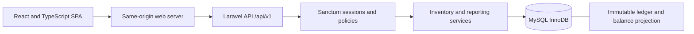

# Phase 0: architecture and discovery

Status: design prepared for review; application implementation has not begun.

## Repository and environment, 2026-10-30

The starting repository contained README, ignore rules, AGENTS instructions, and Git workflow/status documentation. There were no applications, dependency manifests, migrations, tests, containers, or CI workflows.

| Tool | Observed result |
| --- | --- |
| PHP CLI | 8.3.14, WAMP; BCMath, PDO MySQL, mbstring, XML, curl, OpenSSL and zip available |
| Composer | 2.9.7 |
| Node | 24.12.0 |
| npm | 11.6.2 |
| MySQL client | 9.1.0 at WAMP's mysql9.1.0/bin/mysql.exe; not on PATH |
| MySQL server | Not verified; service enumeration was denied by the environment |
| Docker / Compose | Commands unavailable |
| GitHub CLI | Unavailable; Git HTTPS credential works |

PHP emits an Xdebug warning because its configured log file cannot be opened. Do not modify the machine-wide configuration as part of the application scaffold. Tests may run with Xdebug disabled per process when coverage is not requested.

Authenticated GitHub account: `chanakanaveen`, verified via GitHub's authenticated user API. Repository-local author name is `chanakanaveen`, with verified account no-reply email `74520500+chanakanaveen@users.noreply.github.com`. Existing setup history is retained unchanged.

## Target architecture

Single organization, multiple stores. A Laravel modular monolith exposes a versioned JSON API to a React SPA. MySQL InnoDB owns durable business state. No microservices, generic repositories, event sourcing, or queue-dependent stock posting.

Thin controllers use Form Requests, policies, explicit enums, domain services, and API Resources. Posting services own transactions; model observers never mutate inventory. Organize applications in `backend/` and `frontend/`; documentation remains in `docs/`.

## Architecture decisions

| ADR | Decision and reason |
| --- | --- |
| 001: runtime | Target Laravel 13 on PHP 8.3-compatible dependencies; resolve and lock exact packages in Phase 1. Laravel 13 requires PHP 8.3, matching the local major/minor. Use current patched PHP in deployment rather than treating this local patch as a production baseline. |
| 002: persistence | Target MySQL 8.4 LTS in Docker Compose. Local MySQL 9.1 client presence does not prove server compatibility or availability. Never substitute SQLite for locking tests. |
| 003: browser authentication | Sanctum first-party session cookies; same-origin proxy for SPA/API locally and in deployment. Fetch CSRF cookie before login, send X-XSRF-TOKEN for mutations, regenerate session on login and invalidate on logout. No bearer tokens in browser storage. |
| 004: quantities | DECIMAL(18,4), string transport, BCMath scale 4. Reject excess precision; never round submitted quantities silently or use floats for authoritative arithmetic. |
| 005: authorization | Spatie permissions plus Laravel policies and explicit store scope. Admin bypasses store assignments only, never no-self-approval. All transfer access requires access to both stores. |
| 006: tests | PHPUnit for PHP; Vitest and React Testing Library for frontend; Playwright for the real demo flow. Pint and Larastan on backend, TypeScript and ESLint on frontend. Resolve compatible versions in Phase 1. |
| 007: frontend | React, TypeScript, Vite, Tailwind, React Router, TanStack Query, React Hook Form, Zod and Recharts. Keep quantities as strings through forms and API. Never optimistically mark stock as posted. |
| 008: operations | UTC database timestamps; configurable UI timezone with Asia/Colombo demo default. Database-backed sessions; no Redis dependency in MVP. Synchronous posting, any future notifications after commit. |

Version evidence: [Laravel release requirements](https://laravel.com/framework/docs/releases) and [Vite Node requirements](https://vite.dev/guide/), consulted 2026-10-30. Node 24.12.0 meets Vite's documented minimum. These checks are not evidence that dependencies have been installed or resolved together.

## Review decisions and prerequisites

Defaults proposed for approval: cookie auth, access to both transfer stores, creator OR submitter excluded from approval, flat categories, no negative stock, and MySQL 8.4 Compose. No public deployment or license grant is included.

Before Phase 1 acceptance, Docker/Compose and a working isolated MySQL service must be available; dependency resolution must verify Sanctum, Spatie, PHPUnit and Larastan compatibility. If Docker cannot be supplied, obtain agreement on a native-development alternative before claiming the prescribed stack boots. Never guess database credentials or use a pre-existing database for destructive tests.

See [database](database.md), [business rules](business-rules.md), [API](api.md), [security](security.md), [testing](testing.md), and [milestones](milestones.md).
