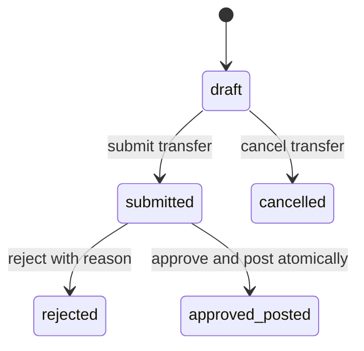

# Inventory lifecycle and posting rules

## State machines

Receipts/issues allow only `draft -> posted` and `draft -> cancelled`. Drafts are editable; submitted transfers and all terminal records are immutable. Rejected transfers require a new draft. No reservations or stock effects occur before posting. A rejected or cancelled record never moves stock.

## Authorization and validation

Active authenticated users need both the action permission and store access. Admin can access all stores but cannot approve a transfer they created or submitted. Other actors must have access to both stores for transfer read, creation, editing, submission, approval, rejection and cancellation. This also scopes lists, counts, exports and the approval inbox. Inactive accounts are denied on every request.

Admin manages masters/users/role assignment and performs inventory actions. Inventory Manager receives/issues and manages transfers including eligible approvals; Store Keeper receives/issues and drafts/submits/cancels transfers but cannot approve/reject. Auditor reads scoped transactions, reports, ledger and audit trails only. Master writes belong to Admin. Managers and Auditors can export reports. Category permissions mirror product read/write rights. Admin and Auditor alone have audit.view.

Drafts require 1–100 unique product lines and active stores/products. Quantities must be decimal strings with at most 14 integer digits and four fractional digits, greater than zero for lines, nonnegative for reorder levels. Normalize accepted strings to four places; reject exponent notation, numeric JSON values, excess precision and overflow. Product base UOM cannot change after historical use.

## Atomic posting

1. Authenticate, validate the request envelope and authorize current resource access, including retries.
2. Start a database transaction. Claim the scoped idempotency key using its unique constraint, then lock the document/transfer row. Concurrent identical keys wait on the unique row and then read the committed result; rollback/restart after a duplicate-key exception where required by transaction behavior.
3. Recheck status, approver identity and permissions. Lock referenced store/product rows in sorted table/ID order with shared locks and confirm active status; deactivation uses exclusive locks. All posting paths use the same lock order.
4. Ensure and lock affected balances in sorted `(store_id, product_id)` order. Validate all source balances and destination overflow before mutating any stock.
5. Update balances with exact arithmetic and append matching ledger entries. Receipt deltas are positive; issues negative; transfer lines produce one negative source and one positive destination delta.
6. Set terminal status, actor and timestamp fields, append a redacted audit record, save the successful idempotent response, and commit once. Exceptions roll back every effect, including the key reservation.

Use at most three whole-transaction attempts for deadlocks. After exhausted transient lock failures return retryable `503 INVENTORY_BUSY`; preserve the key for client retry by rolling back the failed attempt. No network calls or notifications in the transaction. Draft editing/submission locks the parent row, preventing changes during posting. Balance/ledger mutation has no public endpoint.

## Idempotency contract

Require a nonblank, printable ASCII `Idempotency-Key`, maximum 128 characters, on receipt/issue post and transfer approval. Scope by actor, HTTP method, action and resource ID. SHA-256 hash a recursively key-sorted validated payload plus method and canonical resource path, retaining array order and normalized decimals.

Same key/hash returns the stored status/body after fresh authentication and authorization; a different hash returns `409 IDEMPOTENCY_CONFLICT`. Fresh request IDs belong to each response's meta envelope, outside the stored business body. A new key for an already-posted resource returns `409 ALREADY_PROCESSED`. Business failures are not cached; they roll back and may be retried with the same key after correction. In-flight lock timeout returns retryable 503, never a second posting.

Retain successful records for seven days; purge completed expired records in a scheduled command. After expiry, immutable source status and ledger uniqueness still prevent reposting, though historical response replay is no longer guaranteed. Never include credentials in persisted payloads or responses.

## Acceptance example

Opening receipts establish A=100.0000 and B=30.0000. Submitting a transfer of 20.0000 changes neither. A different eligible user approves: A=80.0000, B=50.0000, ledger deltas -20.0000/+20.0000. Any duplicate approval creates zero additional entries. Insufficient source stock leaves status, balances, ledger, audit and idempotency records unchanged.
