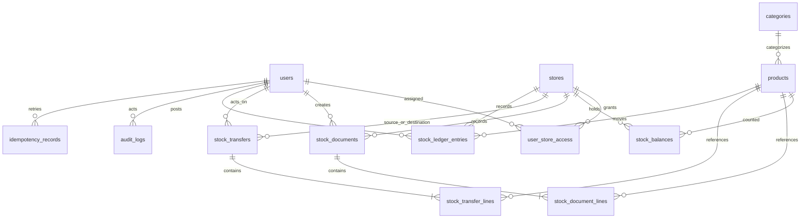

# Normalized database design

Design only; no migrations have run. Use unsigned bigint primary keys, UTC timestamps and InnoDB. Foreign keys restrict historical deletion; deactivate users, stores, categories and products instead. Quantities are DECIMAL(18,4). Use PHP backed enums plus database CHECK constraints for finite states.

| Table | Fields and constraints |
| --- | --- |
| users | id, name, unique email, password hash, is_active, timestamps; Laravel session support |
| roles / permissions / mappings | Spatie standard tables; permission names are server controlled |
| user_store_access | user_id FK, store_id FK; unique pair |
| stores | id, unique code, name, location_label nullable, is_active, timestamps |
| categories | id, name, is_active, timestamps; flat MVP, no parent_id |
| products | id, unique sku, name, category_id FK, base_uom, reorder_level >= 0, is_active, timestamps |
| stock_balances | id, store_id FK, product_id FK, quantity >= 0 default 0, timestamps; unique(store_id, product_id) |
| stock_documents | id, unique number, type receipt/issue, store_id FK, status draft/posted/cancelled, reference and remarks nullable, created_by FK, posted_by FK nullable, posted_at nullable, timestamps |
| stock_document_lines | id, document_id FK, product_id FK, quantity > 0, timestamps; unique(document_id, product_id) |
| stock_transfers | id, unique number, from_store_id and to_store_id FKs (must differ), status draft/submitted/approved_posted/rejected/cancelled, created_by FK, submitted_by/approved_by/rejected_by nullable FKs, submitted_at/approved_at/posted_at/rejected_at nullable, rejection_reason nullable, timestamps |
| stock_transfer_lines | id, transfer_id FK, product_id FK, quantity > 0, timestamps; unique(transfer_id, product_id) |
| stock_ledger_entries | id, store_id and product_id FKs, movement_type receipt/issue/transfer_out/transfer_in, source_type document/transfer, source_id, source_line_id, quantity_delta != 0, balance_after >= 0, posted_at, actor_id FK, created_at; unique(source_type, source_line_id, movement_type) |
| audit_logs | id, actor_id FK nullable, action, subject_type, subject_id, request_id nullable, redacted metadata JSON, created_at |
| idempotency_records | id, actor_id FK, route_key, idempotency_key, request_hash, status completed, response_code, response_body JSON, resource_type, resource_id, created_at, updated_at; unique(actor_id, route_key, idempotency_key) |
| document_sequences | id, kind receipt/issue/transfer, year, last_value unsigned bigint; unique(kind, year) |

Ledger source and audit subject polymorphic IDs cannot use ordinary cross-table FKs. Services derive them from locked persisted rows; clients cannot submit them. Do not expose physical deletes of source records. Ledger is append-only through application interfaces; migration credentials are separate from runtime credentials. Framework sessions/cache tables follow the selected Laravel scaffold.

Flat categories intentionally omit optional hierarchy. Idempotency records persist only completed successes: the in-transaction provisional insert is unobservable to other transactions and rolls back on failure. No durable in-flight status or stale processing recovery job is necessary.

Index ledger `(store_id, product_id, posted_at, id)`, transfers `(status, created_at)`, documents `(type, status, created_at)`, audit `(subject_type, subject_id, created_at)` and idempotency `created_at` for cleanup. Scope foreign keys also receive appropriate indexes. Unique SKU/store code comparisons follow an explicit case-insensitive collation and trimmed normalized input.

Allocate numbers on draft creation in a transaction: insert sequence if missing, lock `(kind, UTC year)`, increment, format RCV/ISS/TRF-YYYY-counter (minimum six digits; never truncate overflow). Never use MAX+1. Rollback undoes allocation; cancellation does not recycle numbers.

Missing balance rows are inserted with a duplicate-key no-op in sorted `(store_id, product_id)` order, then selected FOR UPDATE in that same order. Unique pair constraints are mandatory. Do not use broad INSERT IGNORE to conceal unrelated errors. Check decimal overflow as well as insufficient stock before writing.

Reconciliation uses the union of balance and ledger keys, treating absent quantities as zero, to detect missing balance rows too. Compare each balance with the exact SUM of deltas; every posted source line must have the expected ledger count. Each posted transfer line has one out, one in, and a zero sum. No opening balances outside receipt posting.
