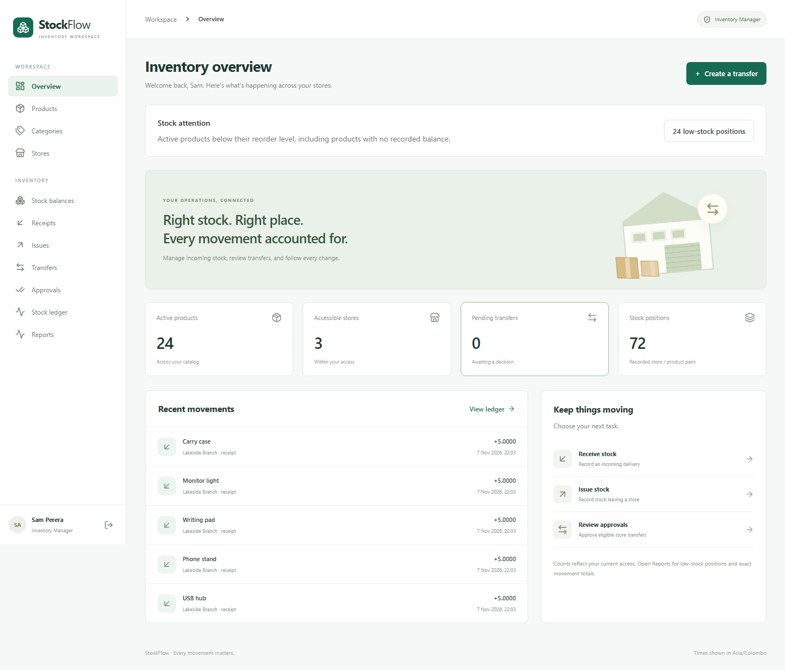
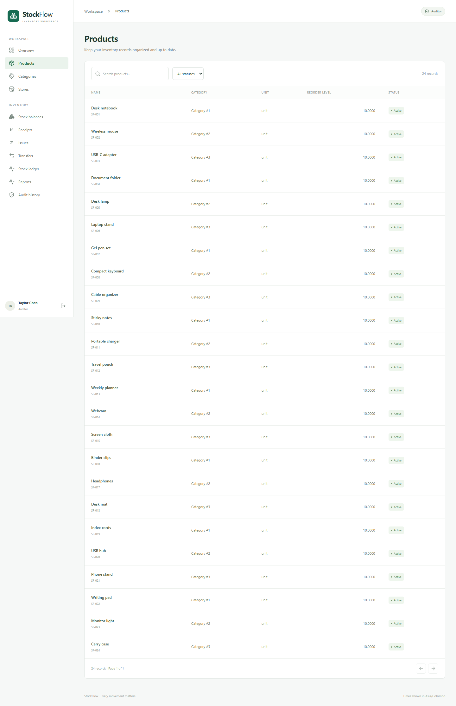
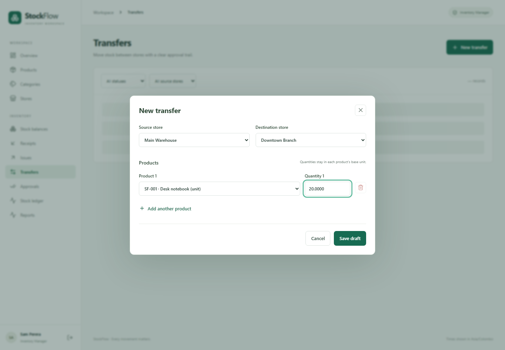
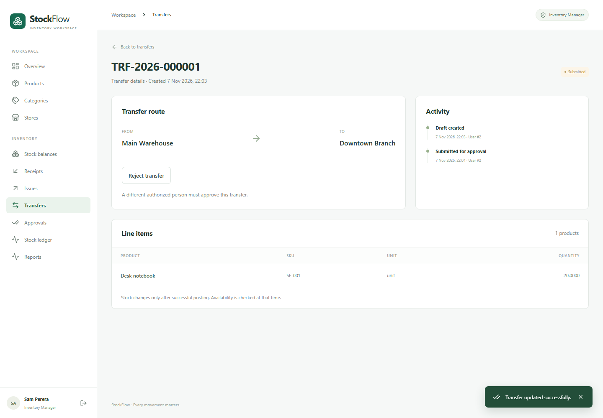
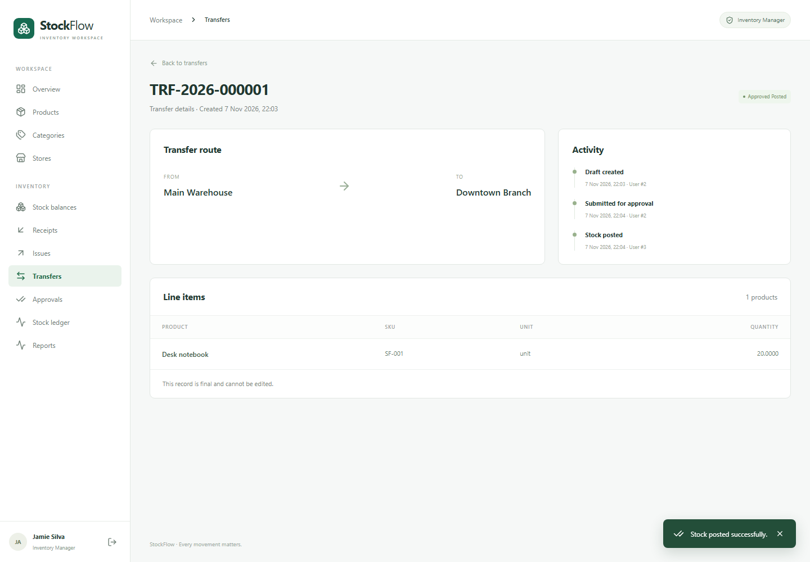
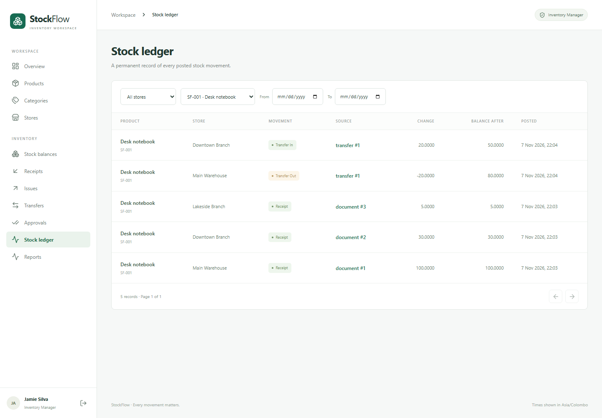
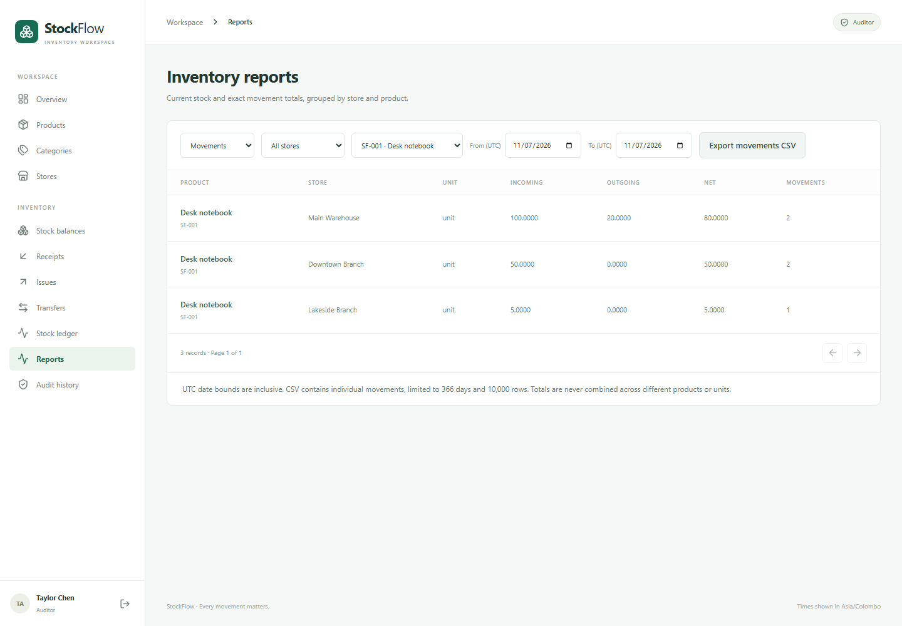
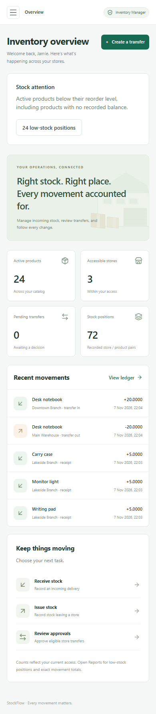

# Reproducible fictional demo

Use [setup](setup.md) for ordinary local accounts. The screenshot dataset is separate: `backend/tests/Support/prepare-browser-demo.php` refuses any environment except testing, MySQL, database `stockflow_test` and user `stockflow_test`, and refuses a database URL override. It resets that test schema only. Never grant the test user access to other databases.

From a fresh checkout, install locked backend/frontend dependencies, copy `.env.testing.example` to backend `.env.testing`, generate a separate test APP_KEY, and configure the provisioned isolated database/user. With MySQL running:

```powershell
cd frontend
npx playwright install chromium
npm run test:e2e
cd ../backend
php artisan inventory:reconcile --env=testing
```

The runner generates an ephemeral password in memory, prepares 3 stores, 24 fictional products across 3 categories and 5 fictional accounts, and runs temporary API/Vite servers on 18100/5174. It does not print or commit the password. The runner stops its web servers on completion; the test database is retained. Re-running resets the fixture. Run separately from PHPUnit.

All 72 opening positions come from three receipts posted through domain services: each product starts at Main 100, Downtown 30 and Lakeside 5. Reorder level 10 gives 24 low-stock examples at Lakeside. Accounts use `@e2e.stockflow.test`: manager and approver are distinct Inventory Managers, plus admin, keeper (Main only), and auditor. These differ from ordinary local seed accounts.

## Walkthrough

1. Manager creates a transfer of SF-001 / Desk notebook, Main to Downtown, quantity 20.
2. Save draft and submit. The creator has no approval action; submission does not move stock.
3. Sign out and use the separate approver; open Approvals and confirm approval.
4. Verify Main 80.0000, Downtown 50.0000 and Lakeside 5.0000.
5. Filter the ledger to SF-001: three opening receipts and exactly two transfer movements, -20.0000 and +20.0000.
6. Reload the posted transfer: approval is unavailable. Backend tests separately verify API retries and simultaneous approvals; a hidden button alone is not proof of idempotency.
7. A 999-unit Main issue stays draft with an insufficient-stock error.
8. Auditor opens low stock and dated movement reports, downloads CSV and views scoped audit history. Reconciliation must report zero mismatches.

For manual recording, prepare the same products and opening receipts in a dedicated local demo through the UI, using manager as creator and admin as a different approver. Never insert balance rows directly. Keep passwords, cookies, environment files and tokens out of recordings.

## Actual gallery

Captured by Chromium against Laravel/MySQL; all names and quantities are fictional. Images show different workflow steps, not one simultaneous snapshot. Dates reflect the capture run.










The browser suite writes captures to ignored `.local/`. Only reviewed, credential-free images are copied here. See [verification](phase6-verification.md); screenshots alone do not establish concurrency safety.
